<p>
  
</p>

<p><b>English</b> · <a href="README.pl.md">Polski</a></p>

<p>
  
  
  
</p>

**Desktop app that converts text to ASCII codes and back.**
Two tabs, “TEXT TO ASCII” and “ASCII TO TEXT”: type the input, click convert, read the result below.

[Report an issue](../../issues)

<p align="center"></p>

## Features

- **Both directions**: text to ASCII and ASCII to text.
- **Dark mode** and fullscreen mode.
- **Resizable window**.

## Quick start

Requirements: Python 3, internet access for `pip`.

```bash
git clone https://github.com/vviktooor/asciiTranslator.git
cd asciiTranslator
pip3 install -r requirements.txt
python3 operations.py
```

## Languages

This README is available in English (default) and [Polish](README.pl.md). Interface: English. Polish interface: planned (WR standard v4.4).

## Repository layout

| Where | What |
|---|---|
| `operations.py` | Entry point and conversion logic |
| `gui.py` | Tkinter window |
| `screenshots/` | Screenshots |

## Tests and quality

| Check | Result | Date |
|---|---|---|
| Tests | NOT VERIFIED (no tests yet) | 2026-11-25 |

## License

No licence file: all rights reserved. Ask before reusing the code.
Author: WR

---

<p align="center"><sub><b>WR</b> · <a href="https://github.com/vviktooor">vviktooor</a></sub></p>
