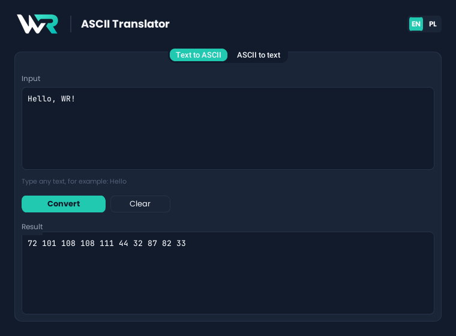

<p>
  
</p>

<p>&nbsp;<a href="README.pl.md"></a></p>

<p>
  
  
  <a href="../../actions/workflows/ci.yml"></a>
  
</p>

**Desktop app that converts text to ASCII codes and back.**
Two tabs, “Text to ASCII” and “ASCII to text”: type the input, click Convert, read the result. Invalid codes are reported, not crashed on. Interface in English or Polish, switchable in the window.

<p align="center"></p>

## Features

- **Both directions**: text to decimal codes and back, full Unicode (Polish letters too).
- **Clear errors**: an invalid code is named in red instead of crashing the app.
- **English and Polish**: EN/PL switch in the window, `APP_LANG=pl` to start in Polish.
- **WR look**: ink background, signal accents, Poppins and JetBrains Mono.

## Quick start

Requirements: Python 3.10+ with Tkinter (`python3-tk` on Linux).

```bash
git clone https://github.com/vviktooor/asciiTranslator.git
cd asciiTranslator
pip3 install -r requirements.txt
python3 -m ascii_translator
```

## Languages

This README is available in English (default) and [Polish](README.pl.md). Interface: English by default, Polish via the EN/PL switch or `APP_LANG=pl` (strings in `ascii_translator/locales/`).

## Repository layout

| Where | What |
|---|---|
| `ascii_translator/convert.py` | Conversion logic, no GUI imports |
| `ascii_translator/gui.py` | CustomTkinter window |
| `ascii_translator/theme.py` | WR colour and font tokens |
| `ascii_translator/locales/` | `en.json` and `pl.json` |
| `tests/` | Unit tests |
| `docs/screenshots/` | Screenshots from the running app (EN and PL) |

## Tests and quality

```bash
ruff check .
ruff format --check .
python3 -m unittest discover -s tests
```

| Check | Result | Date |
|---|---|---|
| ruff | PASS | 2026-11-25 |
| Tests | PASS (10/10) | 2026-11-25 |
| Screenshots | PASS (real app under Xvfb, EN and PL) | 2026-11-25 |

## License

No licence file: all rights reserved. Ask before reusing the code. Author: WR.

Found a bug or have an idea? [Open an issue](../../issues).
