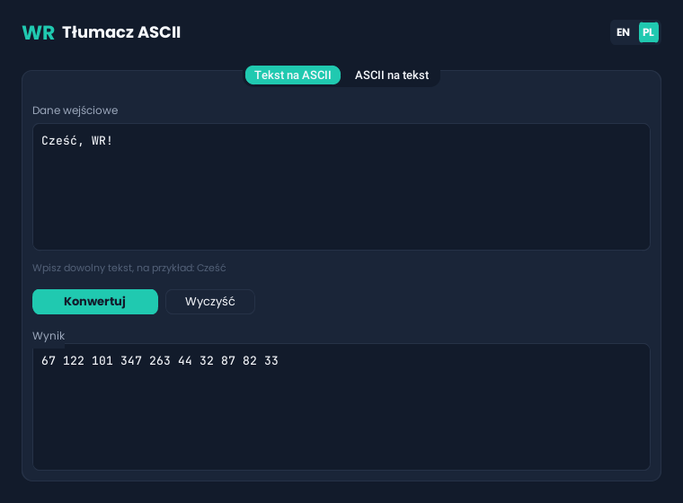

<p>
  
</p>

<p><a href="README.md"></a>&nbsp;</p>

<p>
  
  
  <a href="../../actions/workflows/ci.yml"></a>
  
</p>

**Aplikacja desktopowa, która zamienia tekst na kody ASCII i z powrotem.**
Dwie zakładki, „Tekst na ASCII” i „ASCII na tekst”: wpisz dane, kliknij Konwertuj, odczytaj wynik. Błędne kody są zgłaszane zamiast wywracać program. Interfejs po angielsku lub po polsku, przełączany w oknie.

<<<<<<< Updated upstream

<p align="center"></p>
=======
<p align="center"></p>
>>>>>>> Stashed changes

## Funkcje

- **Oba kierunki**: tekst na kody dziesiętne i z powrotem, pełny Unicode (także polskie litery).
- **Czytelne błędy**: błędny kod jest wskazany na czerwono zamiast wywracać aplikację.
- **Angielski i polski**: przełącznik EN/PL w oknie, `APP_LANG=pl` uruchamia po polsku.
- **Wygląd WR**: tło ink, akcenty signal, Poppins i JetBrains Mono.

## Szybki start

Wymagania: Python 3.10+ z Tkinterem (`python3-tk` na Linuksie).

```bash
git clone https://github.com/vviktooor/asciiTranslator.git
cd asciiTranslator
pip3 install -r requirements.txt
APP_LANG=pl python3 -m ascii_translator
```

## Języki

Ten README jest po polsku i po [angielsku](README.md) (wersja domyślna). Interfejs: domyślnie angielski, polski przez przełącznik EN/PL lub `APP_LANG=pl` (teksty w `ascii_translator/locales/`).

## Struktura repozytorium

| Gdzie | Co |
|---|---|
| `ascii_translator/convert.py` | Logika konwersji, bez importów GUI |
| `ascii_translator/gui.py` | Okno CustomTkinter |
| `ascii_translator/theme.py` | Kolory i czcionki WR |
| `ascii_translator/locales/` | `en.json` i `pl.json` |
| `tests/` | Testy jednostkowe |
| `docs/screenshots/` | Zrzuty z uruchomionej aplikacji (EN i PL) |

## Testy i jakość

```bash
ruff check .
ruff format --check .
python3 -m unittest discover -s tests
```

| Kontrola | Wynik | Data |
|---|---|---|
| ruff | PASS | 2026-11-25 |
| Testy | PASS (10/10) | 2026-11-25 |
| Zrzuty ekranu | PASS (prawdziwa aplikacja pod Xvfb, EN i PL) | 2026-11-25 |

## Licencja

Brak pliku licencji: wszelkie prawa zastrzeżone. Zapytaj przed ponownym użyciem kodu. Autor: WR.

Znalazłeś błąd albo masz pomysł? [Zgłoś go w Issues](../../issues).
